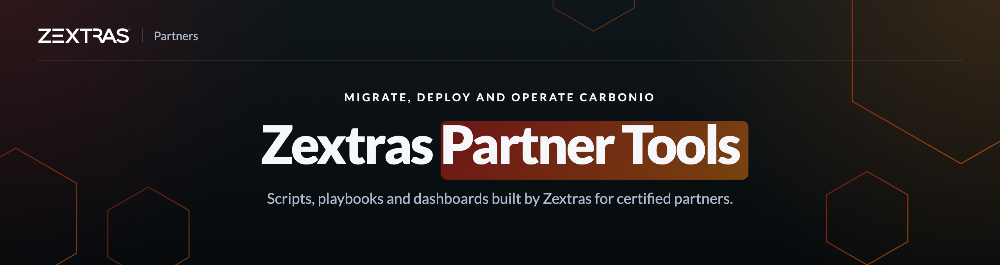

 

Tools that help Zextras partners run Carbonio on their own: migrate customers, deploy, and keep installations healthy. They complement the documentation on the **[Zextras Partner Portal](https://support.zextras.com)**.

### Find the area that fits your needs

|  | Area | What you'll find |
| :---: | --- | --- |
| ⇄ | **Migrate a customer** | From Zimbra, Exchange, IMAP servers and PST archives, with Files and Drive data included. |
| ☰ | **Implement & operate** | SSL certificates, storage volumes, LDAP replica promotion, high availability, database backups. |
| ◎ | **Monitor & troubleshoot** | Grafana dashboards and a diagnostics collector to attach to support tickets. |

### Open to everyone

| Repository | |
| --- | --- |
| [carbonio-collect](https://github.com/Zextras-Partners/carbonio-collect) | Collects Carbonio diagnostics from a mailbox server, ready to share in a Partner Portal ticket |

The other tools are reserved for members of certified partner organizations. Access is managed from the Partner Portal.

### Didn't find what you were looking for?

Let us know what's missing, we'll take it from there: **[open a request on the Partner Portal →](https://support.zextras.com/hc/requests/new)**

© Zextras · <a href="https://www.zextras.com">zextras.com</a> · <a href="https://support.zextras.com">Partner Portal</a>
